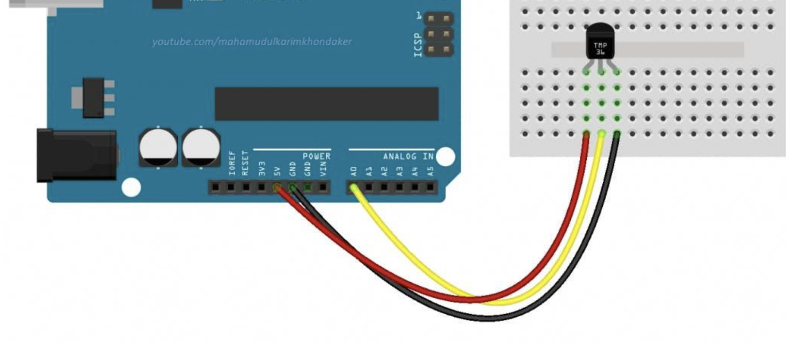

Embedded Sensor Telemetry System

1. Overview

An RTOS-based embedded telemetry system developed for an ELEGOO Mega 2560-compatible board using an ATmega2560 microcontroller and FreeRTOS. The firmware samples a TMP36 temperature sensor, encodes timestamped readings into binary telemetry frames, and communicates with a Python host application over USB serial.

The host application validates incoming frames, displays live telemetry and device status, supports device commands, and records readings in a CSV log.

2. Features

- Periodic temperature sampling using FreeRTOS.
- TMP36 analog temperature acquisition.
- Binary telemetry frames with sequence numbers, device timestamps, and CRC-16 validation.
- Configurable sampling interval and streaming control.
- Normal and low-power sampling modes.
- Python terminal dashboard with live telemetry, command input, and device events.
- TCP serial bridge that keeps the physical serial connection open while the dashboard restarts.
- Persistent CSV logging across dashboard sessions.
- Automated host-side tests for telemetry parsing and protocol validation.

3. Hardware and Software

Hardware
- ELEGOO Mega 2560-compatible board (ATmega2560).
- TMP36 analog temperature sensor.
- Breadboard, jumper wires, and USB data cable.

Software
- Arduino-compatible C++ firmware with FreeRTOS.
- Python 3.
- `pyserial`, `rich`, and `pytest`.
- Arduino CLI or Arduino IDE for firmware compilation and upload.

4. Hardware Wiring

Orient the TMP36 sensor with its flat face toward you and its legs pointing downward.

| TMP36 Pin | Mega 2560 Connection |
|---|---|
| Left | 5V |
| Middle | A0 |
| Right | GND |

The TMP36 temperature sensor is connected to the ELEGOO Mega 2560 as shown below.



The firmware converts the ADC reading into degrees Celsius using the TMP36's nominal 500 mV offset and 10 mV/°C scale. Verify the pinout of your specific sensor before applying power.


5. Python Environment Setup

- Clone the repository and enter its directory:

```
git clone https://github.com/tarunmk/HP-Firmware-Project.git
cd HP-Firmware-Project
```

- Create and activate a virtual environment:

```
python3 -m venv .venv
source .venv/bin/activate
```

- Install the pinned dependencies:

```
python -m pip install -r requirements.txt
```

6. Build and Upload Firmware

Install Arduino CLI, the Arduino AVR board platform, and the `FreeRTOS` Arduino library that provides `Arduino_FreeRTOS.h`.

For the tested setup, the board platform is `arduino:avr`, and the installed FreeRTOS library is `11.1.0-3`. Install compatible versions of these dependencies before compiling the firmware.

- From the repository root, compile the telemetry firmware:

```
arduino-cli compile \
  --fqbn arduino:avr:mega \
  firmware/sensor_telemetry
```

- Upload it after identifying the serial port for your board:

```
arduino-cli board list
arduino-cli upload \
  --fqbn arduino:avr:mega \
  --port <SERIAL_PORT> \
  firmware/sensor_telemetry
```

Replace `<SERIAL_PORT>` with the actual port reported on your computer.

7. Run the Host Application

- Start the serial bridge in the first terminal:

```
source .venv/bin/activate
python host/serial_bridge.py --port <SERIAL_PORT> --baud 115200
```

Replace `<SERIAL_PORT>` with your board's serial port. Keep the bridge running while using the dashboard.

- In a second terminal, from the repository root, activate the environment and start the dashboard:

```
source .venv/bin/activate
python host/telemetry_receiver.py
```

The receiver connects to the bridge at `127.0.0.1:8765`. The bridge accepts one active dashboard client at a time and rejects additional simultaneous clients.

8. Device Commands

Enter commands in the dashboard and press Enter.

| Command | Purpose |
|---|---|
| `RATE,<milliseconds>` | Set the normal-mode sampling interval. Supported range: 100–5000 ms. |
| `POWER_MODE,LOW` | Enable low-power behavior with an effective sampling interval of 5000 ms. |
| `POWER_MODE,NORMAL` | Restore normal-mode sampling behavior. |
| `STREAM,0` | Disable telemetry streaming. |
| `STREAM,1` | Enable telemetry streaming. |
| `STATUS` | Report the configured sampling interval, streaming state, and power mode. |
| `POWER_STATUS` | Report the current power mode. |

The configured normal-mode sampling interval and the effective low-power interval are distinct. Consult [docs/commands.md](docs/commands.md) for the command details and response formats.

9. Telemetry Protocol

The firmware transmits binary telemetry frames containing a synchronization header, message type, payload length, sequence number, device timestamp, temperature, and CRC-16 checksum.

The host parses the mixed text-and-binary stream and validates frames before accepting readings. Refer to [docs/protocol.md](docs/protocol.md) for the exact frame layout, field sizes, byte order, and CRC details.

10. Logging

The host writes accepted telemetry readings to `host/telemetry_log.csv`. The log is opened in append mode, so readings are preserved across dashboard restarts. A header is written when the log is first created or is empty.

The log is generated locally and is excluded from version control.

11. Automated Tests

- From the repository root, activate the Python virtual environment and run:

```
python -m pytest -q
```

The current test suite contains 57 passing tests covering telemetry frame validation and decoding, stream parsing and recovery, power-state handling, CSV logging, and serial bridge startup error handling.

These automated tests primarily validate host-side behavior. They do not replace testing the firmware on the physical development board.

12. Connection Behavior and Hardware Limitation

The serial bridge owns the physical USB serial connection while the dashboard connects to it over TCP. When the dashboard exits and reconnects while the bridge remains running, the device can continue streaming without the dashboard reopening the physical serial port.

During development, opening the USB serial port on the tested ELEGOO Mega 2560-compatible board restarted the telemetry sequence. Changing host-side DTR/RTS settings did not eliminate this observed behavior.

The bridge reduces routine serial-port reopen events when the dashboard restarts. It does not provide automatic recovery from every physical USB disconnection, bridge restart, power cycle, or hardware reset. Physical USB disconnect/reconnect recovery has not been verified as a supported capability.

13. Scope

The implementation has been exercised on the development Mega 2560-compatible board and host computer. Behavior on other board variants and operating systems has not been established. Runtime settings should not be assumed to survive a device reset or power cycle unless explicitly verified.

Low-power mode changes the effective sampling interval to 5000 ms. This implementation does not establish a measured reduction in hardware power consumption; no power-consumption measurement is claimed.

- Potential extensions include:

Measured power optimization: Measure current consumption in NORMAL and LOW modes using suitable power-measurement equipment. Evaluate the effects of sampling frequency, sensor activity, processor utilization, and communication overhead.

Deeper power management: Explore processor sleep states, peripheral power control, and wake-up mechanisms, subject to the microcontroller and RTOS capabilities. These changes would require careful evaluation of timing constraints and task scheduling.

Persistent configuration: Store selected settings, such as the sampling interval and preferred operating mode, in non-volatile memory when persistence is required. Define validation, default-value, and wear-management behavior before implementation.

Broader hardware and operating-system support: Evaluate the firmware on additional supported microcontrollers and RTOS configurations, and test the host application on Linux and Windows. Document any required changes to serial-port handling, timing, and device configuration.

Communication robustness: Extend testing for partial messages, malformed commands, communication interruptions, reconnection, sequence-number rollover, and recovery after device resets. Additional protocol mechanisms could include command transaction identifiers, explicit acknowledgments, and timeout handling where appropriate.

Telemetry reliability and diagnostics: Add configurable logging policies, clearer communication-error reporting, and additional diagnostics for dropped frames, invalid CRCs, sampling delays, and unexpected resets.